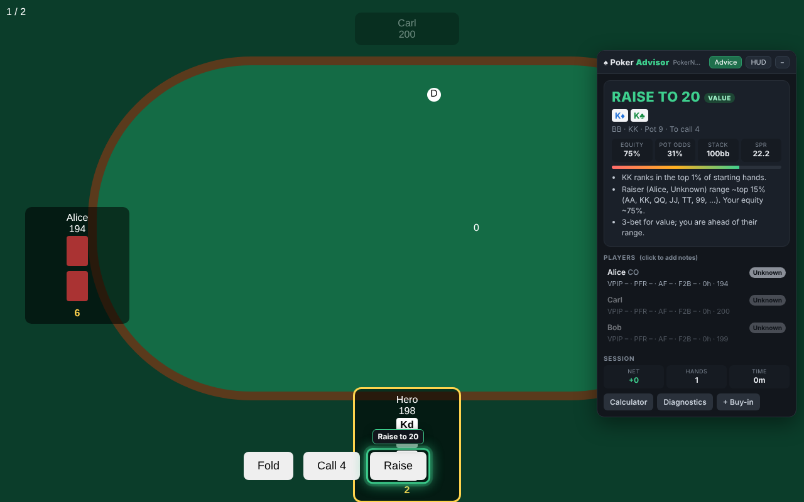

# ♠ Poker Advisor

A Chrome extension that gives real-time strategy advice for **low-stakes No-Limit Hold'em** in the browser. It is built for **[PokerNow](https://www.pokernow.com)** and **KG Poker (kgpoker.fly.dev)**, and can be turned on for other poker sites.

It reads the table, works out your hand's equity against what each opponent is likely holding, and recommends a move: fold, check, call, bet or raise. It then **highlights the button to click** and, for bets and raises, **the box where you type the amount**. It also builds a saved profile for every player you sit with.



## Features

| | |
|---|---|
| **Advice + click highlighting** | A pulsing ring and label show the button to press (*"Raise to 20"*). When the bet box opens, the highlight moves to the box (*"Enter 20"*) and the confirm button. Colours: red = fold, blue = check/call, green = bet/raise, orange = all-in. |
| **Equity engine** | Monte Carlo simulation (about 5,000 run-outs per decision) against each opponent's estimated range. Ranges narrow when opponents bet, raise, overbet or call, so a river raise means more than a flop bet. |
| **Preflop strategy** | Opening ranges by position; isolation raises over limpers; 3-bets for value; set-mining with small pairs when stacks are deep; push/fold below 12 big blinds. |
| **Stack awareness** | Uses effective stack, SPR (stack-to-pot ratio) and how much of your stack a call or bet would risk. **Stack protection** stops you putting most of your chips in with one pair against heavy action. Below 12 BB it switches to push/fold. |
| **Controlled bluffing** | C-bets on dry boards, semi-bluffs with draws, delayed stabs and occasional river bluffs, mixed at random at the frequency you choose. It **never bluffs calling stations or maniacs**, and bluffs are capped at a small part of your stack. |
| **Natural bet sizes** | Sizes are rounded to amounts people actually bet (5, 10, 25, 40, 150, or 2.5 / 7.5 when the blinds are small) and are always a whole number of the smallest chip. A bet that would leave a tiny stack behind becomes all-in. |
| **Player database** | Tracks VPIP, PFR, 3-bet %, aggression factor (AF), fold-to-bet, fold-to-c-bet, went-to-showdown % (WTSD) and hands shown at showdown for every player. Players are auto-classified (Nit, TAG, LAG, Maniac, Calling station, Loose-passive) and the advice adjusts to each type. Notes and manual tags are saved in Chrome storage. |
| **HUD mode** | Shows stats and notes only, with no move recommendations. |
| **Calculator** | Type in hole cards, board, pot and amount to call to get advice on any site, even if the table can't be read. |
| **Session tracking** | Net result, hands, time played and rebuys, with stop-loss and win-goal warnings, tilt detection (three big losses in a row) and break reminders. Session history is on the options page. |
| **Diagnostics** | Shows exactly what the extension read from the page (players, cards, pot, blinds, buttons) so you can fix detection with custom CSS selectors. |

## Install

1. Download this repository (green **Code** button → *Download ZIP*) and unzip it, or `git clone` it.
2. Open `chrome://extensions` and switch on **Developer mode** (top right).
3. Click **Load unpacked** and select the repository folder (the one containing `manifest.json`).
4. Pin **Poker Advisor** from the extensions (puzzle-piece) menu.

Open a table on pokernow.com or kgpoker.fly.dev and the panel appears in the top right. Drag it by its header. **Alt+A** collapses or expands it.

### First-time setup (popup)

- **Your player name**: lets the extension find your seat reliably.
- **Big blind**: leave at 0 to detect it automatically. If the panel says blinds weren't found, enter the big blind here so bet sizes are correct.
- **Style** (tight / balanced / aggressive), **Bluffing** (0–100) and **Stack protection** (0–100).

### Other sites

On any other poker site, open the popup and click **Enable on this site**. Chrome asks for permission for that site only, and the generic table reader is used there. If something isn't read correctly, open **Diagnostics** in the panel, then add CSS selectors for that hostname under *Options → Custom table selectors*, for example:

```json
{
  "example-poker.com": {
    "heroCards": ".my-seat .hole-cards",
    "board": ".community",
    "pot": ".pot-total",
    "raiseButton": "#btn-raise"
  }
}
```

## How the advice works

```
page DOM ──► site adapter ──► tracker ──────────► strategy engine ──► panel + highlight
             (PokerNow /      (actions, stats,     (ranges, equity,
              KG / generic)    session, saved       pot odds, SPR,
                               player profiles)     commitment, sizing)
```

- **Opponent ranges** start from each player's tracked VPIP/PFR, blended with typical low-stakes defaults (VPIP 38%, PFR 12%) until there are enough hands. Ranges are then narrowed by what the player did this hand.
- **Postflop**: value-bet when equity is well above a fair share; call when equity (plus implied odds for draws) beats the pot odds plus a safety margin; raise when very strong; otherwise check or fold. A call or bet that risks a large part of your stack needs both high equity and a hand strong enough for the current SPR.
- **Exploits**: bet bigger and thinner against calling stations, fold more to nits' aggression, trap maniacs, and steal more against tight players.

Every recommendation comes with short reasons (*"Pot odds 25% vs. equity 44% (+ implied odds for your draw): call."*), so you can learn from it rather than follow it blindly.

## Development

No build step: the extension runs straight from the source files.

```bash
npm test            # unit tests: evaluator, equity, sizing, strategy, profiles
npm run test:e2e    # loads the real extension in Chromium against PokerNow-style and generic test tables
npm run rankings    # regenerate the 169-hand preflop ranking (src/core/ranges.js)
```

`test:e2e` needs Playwright with Chromium (`npm i -D playwright && npx playwright install chromium`).

```
manifest.json
src/core/       cards, evaluator, ranges, equity, sizing, profiles, strategy (pure logic, unit-tested in Node)
src/adapters/   dom.js (heuristics), sites.js (PokerNow / KG Poker / generic readers)
src/tracker.js  hand + player + session tracking
src/storage.js  chrome.storage wrapper
src/ui/         in-page panel and highlighter
src/popup/      toolbar popup
src/options/    settings, player database, import/export, custom selectors
tests/          unit + end-to-end tests and test tables
```

## Notes and limitations

- **The extension never clicks or bets for you.** It recommends and highlights; you make every move.
- PokerNow support targets PokerNow's current page layout. KG Poker's layout isn't public, so it uses the generic reader. If a site changes its layout, use Diagnostics and custom selectors (or open an issue).
- Many real-money sites ban real-time assistance software, and private PokerNow games may have house rules. Check the rules of the games you play in. The advice is a strong baseline for low stakes, not a guarantee: poker has variance.
